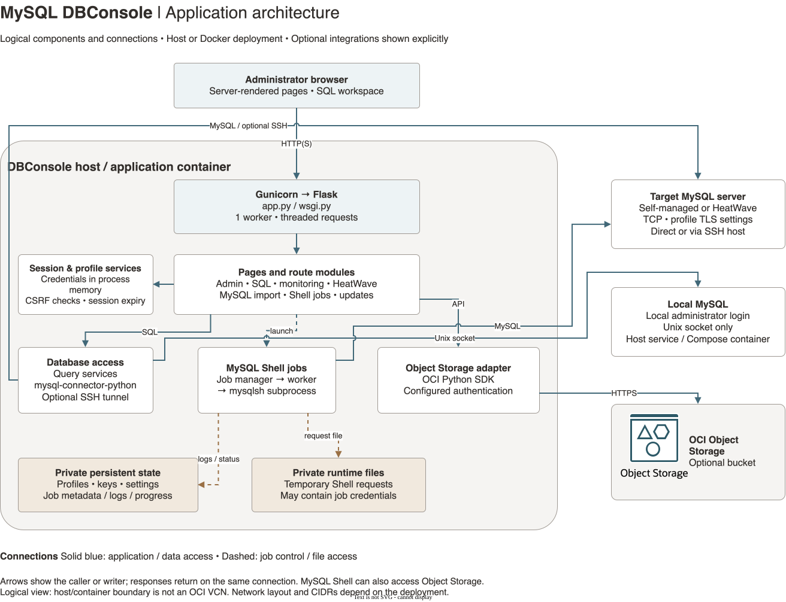

# Architecture

DBConsole is a Python Flask application for MySQL administration, SQL execution, monitoring, MySQL Shell jobs, and optional HeatWave and OCI Object Storage workflows.



[Open the editable draw.io source](diagrams/architecture.drawio) · [View the full-size diagram](diagrams/architecture.svg)

The diagram shows logical components and their connections. The application boundary represents a host process or the DBConsole container. It does not prescribe an OCI region, VCN, subnet, or CIDR; those depend on the installation. Arrows indicate the caller or writer, with responses returning on the same connection. Not every file access is drawn.

## Web application and sessions

[app.py](../app.py) creates the Flask application, configures services, and registers the route modules in [modules/](../modules/). Jinja templates in [templates/](../templates/) provide the browser interface. [wsgi.py](../wsgi.py) exposes the application to Gunicorn.

The host launch scripts run one Gunicorn worker with eight threads by default. The single worker matters: authenticated credentials and active session state live in process memory in `SessionManager`, rather than a shared session database. Restarting the process loses those active sessions. Adding workers or replicas would require a coordinated session and connection design.

Browser session cookies carry session identifiers and related Flask session metadata; database passwords remain on the server. Mutating requests use CSRF validation. HTTPS startup enforces secure session cookies.

## Database connections

The query services use `mysql-connector-python` through [mysql_util.py](../modules/mysql_util.py). Connection profiles support direct TCP connections with configurable TLS, optional SSH forwarding, and Unix sockets. Remote targets can be self-managed MySQL or a compatible HeatWave database. HeatWave features use SQL against the selected database.

Local administrator access uses a local MySQL instance over a Unix socket. On a host, setup provisions the local service. In Docker, a separate MySQL Innovation container shares its socket volume with DBConsole and disables MySQL network listeners. This local database authenticates local administrator access; application profiles and job records are stored in files.

## MySQL Shell jobs

[mysqlsh_jobs.py](../modules/mysqlsh_jobs.py) records job metadata and launches a separate Python job worker, which starts `mysqlsh`. Dump/load jobs can connect to the selected MySQL target and use supported local or Object Storage destinations. The web application reads job status and logs for the job pages.

Job requests are written to private runtime files and can contain credentials needed by the subprocess. The worker removes the request file during cleanup; startup reconciliation also handles stale requests and interrupted workers. Persistent job metadata, logs, and progress files are kept separately from those temporary requests.

## State and external integrations

| Location | Contents |
| --- | --- |
| Process memory | Active login credentials, session feature state, cached database connections and SSH tunnels |
| `DBCONSOLE_STATE_DIR` (source default: `.state`) | Password-free connection profiles, Flask signing key, uploaded SSH keys, Object Storage settings, MySQL Shell options and PAR registry, job records and update status |
| `DBCONSOLE_RUNTIME_DIR` (source default: `.runtime`) | Temporary runtime files, including credential-bearing MySQL Shell requests |
| Docker state volume | Persistent state mounted at `/var/lib/dbconsole`, including any uploaded private OCI configuration |
| Docker MySQL volumes | Database data and the shared Unix socket, separate from the application state volume |

Private directories and files use restrictive permissions through [runtime_util.py](../modules/runtime_util.py). `profiles.json` excludes database passwords, but the state directory still contains sensitive keys and configuration.

The Object Storage adapter uses the OCI SDK. Host and OCI Compute installations use Instance Principal. Docker selects a usable stored OCI config profile first and attempts Instance Principal when no usable stored config is available, as configured in [compose.yaml](../docker/compose.yaml). Object Storage is optional and its authentication is separate from the selected MySQL login. See [OCI prerequisites](prerequisites-oci.md) for bucket and IAM setup.

Admin Auto-Update uses the update service and a separate update worker to refresh code and dependencies and restart DBConsole. See [Operations](operations.md) for the distinction between application updates and host provisioning.

## Deployment options

| Deployment | Browser entry point | Runtime and database placement |
| --- | --- | --- |
| Oracle Linux 9 / Ubuntu host | HTTPS `443` or HTTP `80` by default; configurable | Gunicorn managed by systemd; local MySQL uses a Unix socket; remote databases are profile targets |
| Docker Compose | Host port `8080` mapped to application port `8080` over HTTP | DBConsole and local MySQL run in separate containers; shared socket and persistent volumes |
| Source development | Flask port `5001` in the README example | Developer-managed Python environment and database connections |

OCI Compute is a host deployment. Its subnet routing, security rules, and outbound access must support the chosen browser, database, SSH, and Object Storage connections. The repository supplies setup scripts, but does not define a single deployed OCI network topology.

## Editing the diagram

Open [architecture.drawio](diagrams/architecture.drawio) in draw.io / diagrams.net. Components inside the application boundary are actual child cells, so they move with the boundary. The Object Storage symbol retains the native shapes from the official Oracle OCI Library; colors follow the bundled Oracle architecture toolkit. This does not imply Oracle authorship or endorsement.

After editing, export the first page as SVG with the embedded diagram enabled and replace `docs/diagrams/architecture.svg`. Both this document and the README reference that same image. With draw.io Desktop installed on macOS:

```bash
/Applications/draw.io.app/Contents/MacOS/draw.io \
  --export --format svg --embed-diagram \
  --output docs/diagrams/architecture.svg \
  docs/diagrams/architecture.drawio
```

Inspect the exported image for clipped labels and connector crossings before committing the source and export together.
