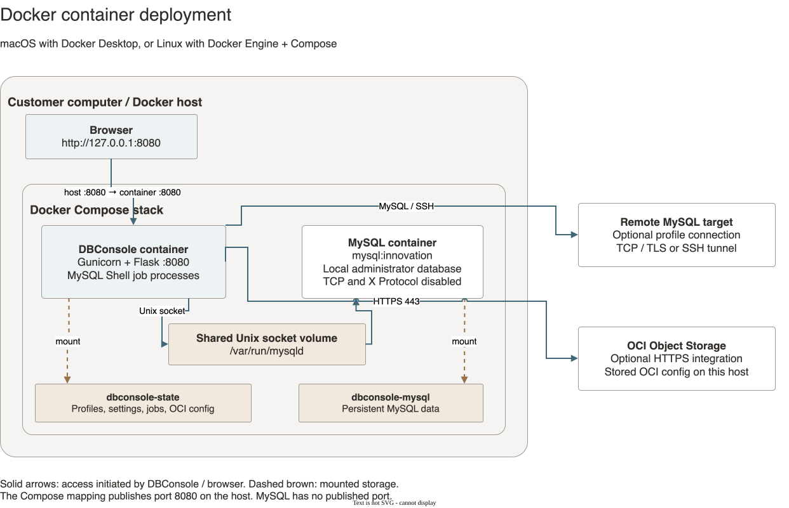
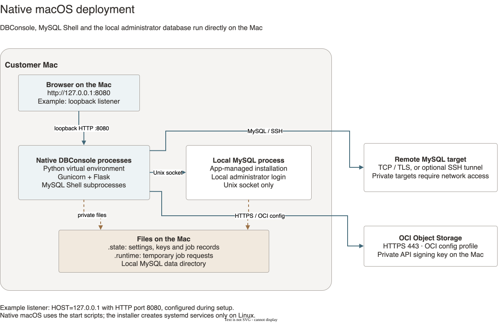
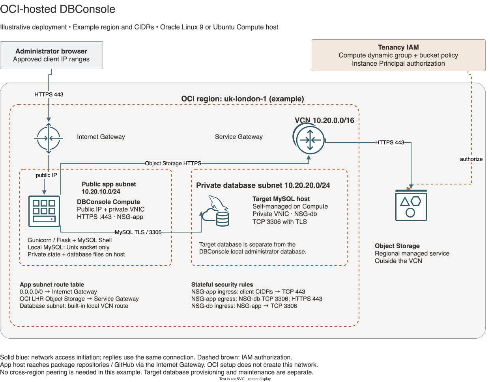

# Architecture

DBConsole can run in Docker, directly on a Mac, or on an OCI Compute host. Each deployment below has its own diagram and runtime details. Object Storage access uses **OCI config outside OCI** and **Instance Principal on an OCI host**.

| Deployment | Where DBConsole runs | Local administrator database | Object Storage authentication |
| --- | --- | --- | --- |
| [Docker](#docker-containers) | Application container on macOS or Linux | Separate MySQL container, shared Unix socket | OCI config for a customer machine outside OCI |
| [Native macOS](#native-macos) | Python environment directly on the Mac | App-managed MySQL process, Unix socket | OCI config, explicitly enabled for the native runtime |
| [OCI host](#oci-host) | Oracle Linux 9 or Ubuntu Compute instance | Local MySQL service, Unix socket | Compute Instance Principal and IAM policy |

## Docker containers



[Diagram source](diagrams/architecture-docker.drawio)

Docker Compose runs two containers: DBConsole contains Gunicorn, Flask, and MySQL Shell; the companion `mysql:innovation` container provides the local administrator database. The browser connects through host port `8080`, mapped to port `8080` in the application container. The Compose mapping publishes this port on the host; `127.0.0.1:8080` is the local browser address.

The containers share `/var/run/mysqld` through the `dbconsole-mysql-socket` volume. Local administrator login uses that Unix socket. MySQL classic and X Protocol networking are disabled, and no MySQL port is published. Additional connection profiles reach remote MySQL targets over TCP with the selected TLS settings, optionally through an SSH tunnel. Private targets require a reachable network path.

Three named volumes have separate roles:

| Volume | Purpose |
| --- | --- |
| `dbconsole-state` | Profiles, settings, job records, and private OCI config/key files at `/var/lib/dbconsole` |
| `dbconsole-mysql` | Persistent local MySQL database files |
| `dbconsole-mysql-socket` | Shared socket path; no durable database data |

For a customer machine outside OCI, configure **Admin > Setup Object Storage > OCI Config** with the API user, fingerprint, tenancy, region, profile name, and private key. Select that profile for the Object Storage target. These credentials are for Object Storage; MySQL login remains separate. The Docker defaults select stored OCI config first and only attempt Instance Principal if no usable config is available. That fallback requires OCI Compute and will not authenticate a local customer machine.

Start or refresh the stack with `./docker/setup_docker.sh`. Image replacement preserves the named volumes. In-application Auto-Update is unavailable in Docker; update by rebuilding the stack. See the [Docker guide](../docker/README.md).

## Native macOS



[Diagram source](diagrams/architecture-macos.drawio)

The Mac runs DBConsole directly in a Python virtual environment. Gunicorn serves Flask, MySQL Shell runs as job subprocesses, and the app-managed MySQL installation supplies local administrator access over a Unix socket. There are no containers or Docker volumes in this option. Connection profiles can also reach remote databases through TCP/TLS or an SSH tunnel.

For the loopback HTTP listener shown in the diagram, configure an unprivileged port during setup and start the application:

```bash
HOST=127.0.0.1 ./setup.sh macos http --http-port 8080
DBCONSOLE_OBJECT_STORAGE_AUTH_MODE=oci_config \
DBCONSOLE_STATE_DIR="$PWD/.state" \
DBCONSOLE_OCI_CONFIG_DIR="$PWD/.state/oci-config" \
./start_http.sh
```

Open `http://127.0.0.1:8080`. HTTPS is also available through `start_https.sh` with a configured certificate and key. Setup creates systemd services only on Linux; the Mac uses the start scripts.

**Outside OCI, use OCI config for Object Storage.** Set `DBCONSOLE_OBJECT_STORAGE_AUTH_MODE=oci_config` whenever launching the native application, and point `DBCONSOLE_OCI_CONFIG_DIR` to the `oci-config` directory inside the configured state directory, as above. Persist these settings in the launch environment for subsequent starts. The unconfigured native runtime defaults to Instance Principal, so the explicit setting is required on a Mac. Enter the profile and private key under **Admin > Setup Object Storage > OCI Config**, then select that profile for the bucket. The uploaded config and key remain private files on the Mac. Alternatively, leave `DBCONSOLE_OCI_CONFIG_DIR` unset and select an existing standard OCI config through `OCI_CONFIG_FILE` (default `~/.oci/config`) and `OCI_CONFIG_PROFILE`; use the matching profile name for the Object Storage target.

Settings, keys, profiles and job records default to `.state`; temporary job requests use `.runtime`. Local MySQL keeps its own data directory under the embedded server installation. Database passwords are excluded from `profiles.json`, but private keys and other sensitive state still need to remain protected. Closing or restarting DBConsole loses in-memory login sessions; persistent files remain on disk.

## OCI host



[Diagram source](diagrams/architecture-oci.drawio)

This is an **illustrative single-region deployment**, not a network provisioned by the repository. It uses `uk-london-1` and example CIDRs. DBConsole runs directly on an Oracle Linux 9 or Ubuntu Compute instance, managed by systemd. Gunicorn terminates HTTPS on port `443`; MySQL Shell jobs and a socket-only local administrator MySQL service run on the same instance.

A separate, self-managed MySQL target runs on Compute in the private database subnet. That target is distinct from the local administrator database. A HeatWave DB system could be selected instead, but its endpoint and service-managed networking would need a corresponding deployment design; the diagram specifically shows self-managed MySQL.

### Network placement and routes

| Resource | Example placement and connectivity |
| --- | --- |
| VCN | `10.20.0.0/16`, containing both application and database subnets |
| Public application subnet | `10.20.10.0/24`; DBConsole Compute VNIC has a private address and an assigned public IP |
| Private database subnet | `10.20.20.0/24`; target MySQL host has a private VNIC and no public IP |
| Internet Gateway | Attached to the VCN; application subnet route `0.0.0.0/0` targets this gateway |
| Service Gateway | Attached to the VCN and enabled for regional Object Storage; application subnet routes the `OCI LHR Object Storage` service destination to it |
| Object Storage bucket | Regional managed service outside the VCN and customer subnets |

The browser reaches the application public IP through the Internet Gateway over HTTPS. The application reaches the database private address using the VCN's built-in local routing. It reaches Object Storage over HTTPS through the Service Gateway; GitHub and package repository traffic uses the Internet Gateway. The service destination and enabled gateway service must match. See Oracle's [Internet Gateway](https://docs.oracle.com/en-us/iaas/Content/Network/Tasks/managingIGs.htm) and [Service Gateway](https://docs.oracle.com/en-us/iaas/Content/Network/Tasks/servicegateway.htm) documentation.

The private database subnet needs no default internet route for the depicted application-to-database connection. Provisioning and patching that target are separate: add a suitable controlled outbound path if its maintenance requires internet access. There is no cross-region peering in this example.

### Security and Object Storage identity

Use stateful rules that allow application ingress on TCP `443` only from approved administrator client CIDRs. Allow application egress to the database NSG on TCP `3306`, and the corresponding database ingress from the application NSG. Permit application HTTPS egress for Object Storage and installation/update dependencies, and configure the host firewall consistently. If SSH administration is needed, allow TCP `22` only from an approved administration source.

**On OCI Compute, use Instance Principal for Object Storage.** A dynamic group identifies the DBConsole Compute instance, and a tenancy IAM policy grants the required bucket permissions. IAM is an authorization relationship, separate from network routing; neither a policy nor a Service Gateway alone supplies the other. No uploaded OCI API key is needed for this option. See [OCI prerequisites](prerequisites-oci.md) for the bucket and policy requirements.

State, keys, local MySQL data and job files reside on the host's disk. A host replacement needs those files and database data preserved or restored. Use the [OL9](../OL9/README.md) or [Ubuntu](../ubuntu/README.md) installation guide. The setup scripts configure the application and host services; create OCI networking, VNIC/public IP settings, NSGs and IAM separately.

## Shared application behavior

[app.py](../app.py) registers the route modules and services in [modules/](../modules/), and [wsgi.py](../wsgi.py) exposes Flask to Gunicorn. Jinja templates provide the browser interface. SQL administration, monitoring and HeatWave operations use the selected database connection through `mysql-connector-python`.

The supplied host launch scripts use one Gunicorn worker with eight threads by default. Credentials, active session state, database connections and SSH tunnels are kept in process memory. Restarting the application loses active login sessions. Adding workers or replicas would require a coordinated session and connection design. Browser cookies contain session identifiers and related metadata; database passwords remain server-side. Mutating requests use CSRF validation, and HTTPS startup enforces secure session cookies.

MySQL Shell jobs use separate Python workers and `mysqlsh` subprocesses. Persistent job metadata, logs and progress are stored under `DBCONSOLE_STATE_DIR`. Temporary requests under `DBCONSOLE_RUNTIME_DIR` can contain execution credentials; worker cleanup and startup reconciliation remove requests when appropriate. Private state uses restrictive directory and file permissions. Native host Auto-Update runs through a separate update worker; see [Operations](operations.md).
